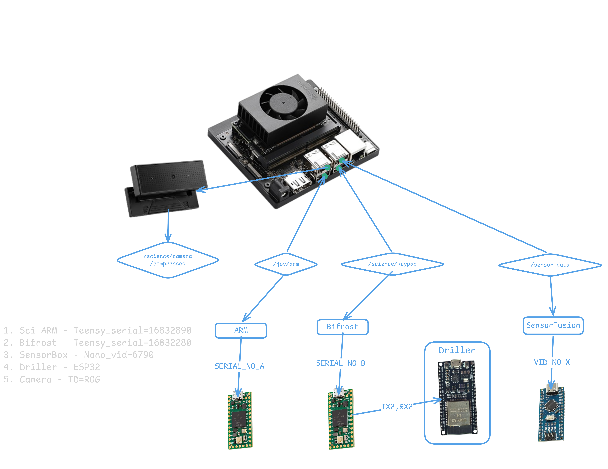

# Science Mission ROS2 PKG




## Setup
```bash
# USB UART & Keyboard input permission
sudo usermod -aG dialout $USER
sudo usermod -aG input $USER
```

## Serial Device Configuration

This project uses **serial number-based detection** instead of hardcoded port names (e.g., `/dev/ttyACM0`). This ensures the code works regardless of which USB port the device is connected to.

### Identifying Device Serial Numbers

To find the serial numbers of connected USB serial devices:
```bash
python3 resource/get_all_serial.py
```

Example output:
```
PORT            | SERIAL               | VENDOR                    | PRODUCT
----------------+----------------------+---------------------------+------------------
/dev/ttyACM0    | 16832280             | Teensy (0x16c0)           | Teensy UART
/dev/ttyUSB0    | FTHR11AB             | FTDI (0x0403)             | FT232R USB UART
```

### Updating Serial Numbers in Code

When replace a TEENSY or other USB device:

1. **Scan for the new serial number:**
   ```bash
   python3 resource/get_all_serial.py
   ```

2. **Update the serial number in the code** (e.g., in `bifrost_node.py`):
   ```python
   TEENSY_SERIAL = "16832280"  # Replace with your device's serial number
   ```

3. **The port will be detected automatically** — no need to change `/dev/ttyACM0` or `/dev/ttyUSB0` references.

The code uses `get_tty_from_serial()` to dynamically resolve the correct `/dev/ttyXXX` port based on the serial number.